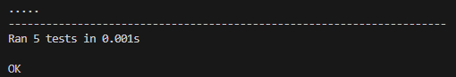

# Linked Lists and Recursion Lab

## Overview

This project demonstrates the use of a **singly linked list** and **recursion** in Python.

The linked list stores integer values inside `Node` objects. The `LinkedList` class provides methods for inserting nodes, calculating the sum of all values recursively, searching for a target value recursively, reversing the linked list recursively, and displaying the contents of the list.

The purpose of this lab is to practice working with node-based data structures and recursive problem solving.

---

## Project Structure

```text
.
├── README.md
├── __init__.py
├── linked_list.py
├── main.py
└── tests/
    ├── __init__.py
    └── test_linked_list.py
```

---

## Features

The project includes the following functionality:

- Create individual `Node` objects
- Create an empty `LinkedList`
- Insert nodes at the front of the list
- Insert nodes at the end of the list
- Recursively calculate the sum of all node values
- Recursively search for a target value
- Recursively reverse the linked list
- Display the linked list in a readable format

---

## Linked List Structure

Each node contains:

- `data` — the integer value stored in the node
- `next` — a reference to the next node in the linked list

The `LinkedList` class stores a reference to the first node using `head`.

Example:

```text
head
 ↓
5 -> 10 -> 25 -> 50 -> 99 -> None
```

---

## Recursion

This lab uses recursion for three linked list operations.

### Recursive Sum

The recursive sum method adds the value of the current node to the sum of the remaining nodes.

The base case occurs when the current node is `None`, which returns `0`.

Example:

```text
5 + 10 + 25 + 50 + 99 = 189
```

### Recursive Search

The recursive search method checks each node for a target value.

- Returns `True` if the target is found
- Returns `False` if the end of the list is reached without finding the target

Example:

```python
new_list.recursive_search(25)
```

Output:

```text
True
```

### Recursive Reverse

The recursive reverse method changes each node's `next` reference so the linked list points in the opposite direction.

Before:

```text
5 -> 10 -> 25 -> 50 -> 99 -> None
```

After:

```text
99 -> 50 -> 25 -> 10 -> 5 -> None
```

---

## Running the Project

This project does not require any third-party Python packages.

From the project directory, run:

```bash
python main.py
```

Example output:

```text
5 -> 10 -> 25 -> 50 -> 99 -> None
189
True
99 -> 50 -> 25 -> 10 -> 5 -> None
```

The output demonstrates:

1. The original linked list
2. The recursive sum of all node values
3. A recursive search for the value `25`
4. The recursively reversed linked list

---

## Running the Tests

The project uses Python's built-in `unittest` framework.

Run the test suite with:

```bash
python -m unittest tests/test_linked_list.py
```

Successful test output:

```text
.....
----------------------------------------------------------------------
Ran 5 tests

OK
```

The tests verify:

- Inserting nodes at the front of the list
- Calculating the sum of an empty linked list
- Calculating the recursive sum
- Recursive searching
- Recursive list reversal

---

## Files

### `linked_list.py`

Contains the `Node` and `LinkedList` classes.

The `LinkedList` class includes:

```text
insert_at_front()
insert_at_end()
recursive_sum()
recursive_search()
recursive_reverse()
display()
```

### `main.py`

Creates a sample linked list and demonstrates the available linked list and recursive operations.

### `tests/test_linked_list.py`

Contains the automated tests used to verify the linked list implementation.

---

## Example

The sample list created in `main.py` is:

```text
5 -> 10 -> 25 -> 50 -> 99 -> None
```

The recursive sum returns:

```text
189
```

Searching for `25` returns:

```text
True
```

After recursively reversing the list:

```text
99 -> 50 -> 25 -> 10 -> 5 -> None
```

---

## Concepts Practiced

This lab reinforces the following Python and computer science concepts:

- Classes and objects
- Singly linked lists
- Nodes and references
- Traversing linked lists
- Recursive functions
- Base cases
- Recursive cases
- In-place data structure modification
- Automated testing with `unittest`

---

## Testing Status

All provided tests are currently passing:

```text
5 tests passed
```

---

## Screenshot

### Testing Suite Success



## Author

Created by Matthew Swanberg as part of Course 8 Module 7 (Linked Lists and Recursion)